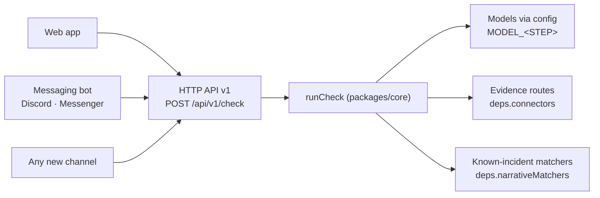

# Extensibility: new channels, models and sources without rebuilding the solution
How to add a channel, swap a model or plug in a source, and which tests prove it. Covers the brief's bonus item "architektura umożliwiająca podłączanie kolejnych kanałów, modeli i źródeł bez przebudowy całego rozwiązania" (source: sources/2026-11-21-msz-pelna-tresc-zadania.pdf, sec. 3) and hard constraints 18-19 ([rules/hard-constraints.md](../rules/hard-constraints.md)). Built 2026-11-21 (user). Code map: [codebase.md](codebase.md).

## The seams

Every seam is a typed interface; the verification rules in between (quote check, verdict rules, number check) never change when a channel, model or source is added.

## A new channel
- A channel is an adapter that sends `POST /api/v1/check` (or calls `runCheck` in-process) and renders the [contract v1](../product/response-contract.md) response. It never decides anything itself (hard constraint 18).
- `channel` is `web`, `api` or `messaging`; any chat platform is `messaging`, so a new platform needs **no contract change**. Server clients authenticate with `X-Client-Key` and get per-end-user rate limits (`CLIENT_KEYS`, [api-reference](api-reference.md)).
- Examples in the repo: `apps/web` (browser), `apps/bot` (one bot for Discord and Messenger, plus a console channel), `eval/run.ts` (in-process and over HTTP).
- Proof: the channel-consistency cases (`G` in `eval/cases.json`, and `pipeline_test.ts` "G: the same input twice…") show web and messaging get the same verdicts and citations.

## A new or different model
- Each LLM step reads its model from config ([decisions/003](../decisions/003-config-in-code.md)): `MODEL_CLAIM_EXTRACTION`, `MODEL_EVIDENCE_ASSESSMENT`, `MODEL_IMAGE_EXTRACTION`. Set the env var on the server and restart: no code change, no rebuild (hard constraint 19). Defaults and the reasons for them: [model-selection.md](model-selection.md).
- Provider routing is per model family in `config.ts` (`routingFor`): Mistral is pinned to its EU endpoint; other families get `data_collection=deny` and zero data retention.
- Every check logs the model and prompt version (`meta.models`, `meta.prompt_versions`), so results stay comparable. After a swap, run `bun run eval` and compare macro-F1 ([benchmark](../evaluation/benchmark.md)).
- Proof: `core_test.ts` "models: MODEL_<STEP> env overrides…" and `pipeline_test.ts` "extensibility: the model comes from config…".

## A new evidence source
1. Implement the `Connector` interface (exported from `@prawdowid/core`): `id`, `label`, `required` (a required route that fails makes the claim a system state, never "brak dowodów"), `appliesTo(claim)`, `unavailableReason(ctx)` (missing key, empty index) and `search(claim, ctx)` returning `SourceRecord[]`. Use `fetchJson`/`fetchText` for one retry and the standard error mapping.
2. Build each `SourceRecord` **only from the source's own fields**: title, publisher, url, dates, `tier` (`official`, `factcheck`, `media`, `other`), `origin_key` (same origin counts once) and the `text` the assessment model quotes from. The model never writes any of these (hard constraint 2).
3. Add the publisher to the trusted-source catalog (`sources/catalog.ts`, [decision 008](../decisions/008-trusted-source-allowlist.md)) so it is listed publicly at `GET /api/v1/sources`.
4. Register it: either in the deployment profile `CONNECTORS` (`connectors/mod.ts`), or **without touching the core** by passing `deps.connectors` to `runCheck` (e.g. `[...CONNECTORS, myRoute]`) from an adapter.
5. Test it with scripted HTTP like the existing routes (`test/harness.ts`), including the failure path (timeout, 403) so an outage is a system state.

`GET /api/v1/sources` now also lists the routes the deployment runs (`routes`, `context_routes`). Proof: `pipeline_test.ts` "extensibility: a new evidence route plugs in through deps.connectors…" injects a route the core has never seen and gets a verdict and a citation from it, with no built-in source called.

### Swapping storage behind an existing route
A source can also change one level lower, without a new connector: the `corpus` route reads through the `CorpusStore` interface (`search`, `upsert`). `IndexedCorpusStore` loads the local BM25 snapshot in `apps/api/main.ts`; a later store can replace it without changing the pipeline.

## A new known-incident catalog
- Implement `NarrativeMatcher` (`id`, `catalog`, `label`, `unavailableReason`, `match`) and add it to `NARRATIVE_MATCHERS` or pass `deps.narrativeMatchers`. Matchers of one catalog are alternatives (an offline index first, a live search second).
- Matches are **context only**: a warning plus `context_matches`, never evidence or a verdict (hard constraints 5-6). Example: EUvsDisinfo ([euvsdisinfo-mcp](euvsdisinfo-mcp.md)).

## What is not swappable without code (on purpose)
- **Verdict rules and the quote check** live in code (`verdict.ts`, `assess.ts`) so no channel, model or source can change how truth is decided.
- **Prompts** are versioned files (`prompts/*.vN.ts`); a change bumps the version and needs an eval run ([prompts/README.md](../prompts/README.md)).
- **The response contract** is v1 and additive-only ([decisions/006](../decisions/006-api-contract-v1-and-mock.md)).
