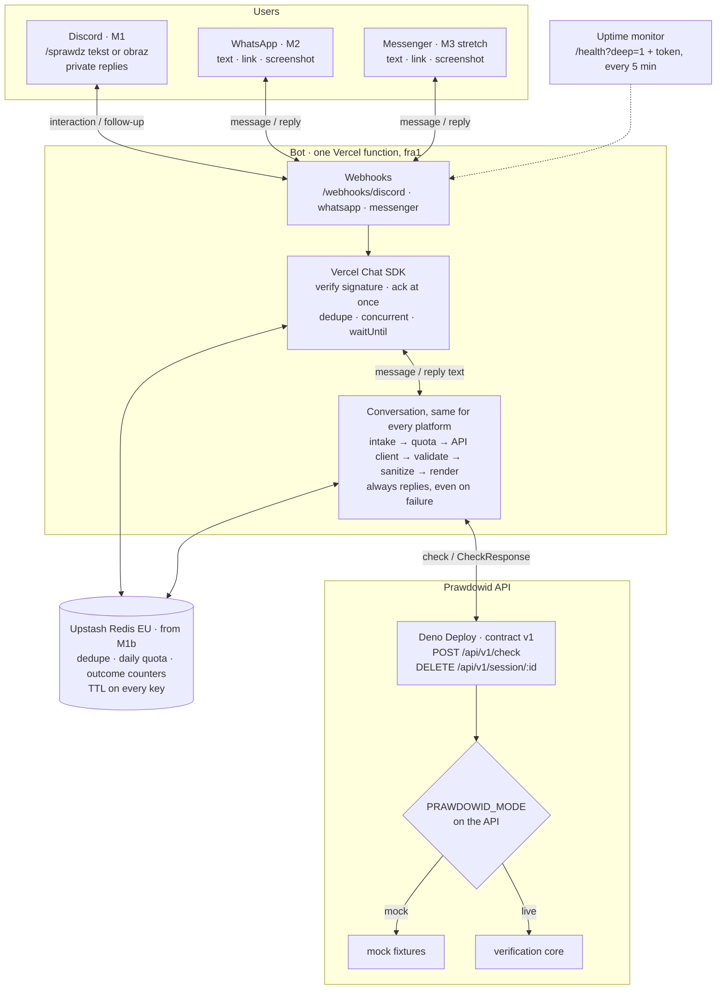

# Messaging bot: Discord, WhatsApp and Messenger on the Vercel Chat SDK
The design of the second channel. One bot service on the [Vercel Chat SDK](https://chat-sdk.dev/docs), hosted on Vercel, serves all three platforms and calls the Prawdowid API over HTTP. **Status: M1 code written in `apps/bot` (2026-11-21), not deployed yet.** It covers the console channel, Discord `/sprawdz` (text and `obraz`), `/pomoc` and `/usun-dane`, plus WhatsApp and Messenger handlers, the sanitizer, the guaranteed reply and the log line. No Redis yet (M1b). What is built and verified: [Implementation status](#implementation-status-2026-11-21). An earlier prototype was removed at the user's request; its findings are below. The design went through a 3-reviewer council (2026-11-21). Decided in [decision 007](../decisions/007-messaging-bot-chat-sdk.md). Setup, env vars, acceptance tests and the demo runbook: [messaging-bot-runbook.md](messaging-bot-runbook.md). The API: [api-reference.md](api-reference.md). What it renders: [response-contract.md](../product/response-contract.md).

## Diagram

## Components
| Component | Responsibility |
|---|---|
| Webhooks | **One Vercel function**: a single catch-all Hono entry serves `/webhooks/:platform` and `/health`, so the keep-warm ping and Discord hit the same instance. **Production URL only**, since preview URLs sit behind Deployment Protection. Meta's GET verification handshake. `GET /health` lists the enabled platforms (never secrets). `GET /health?deep=1` requires `HEALTH_TOKEN` in the `Authorization` header (never in the URL, which would end up in logs) and is cached 60 s. It runs one mock round-trip (free), pings Redis, and reports the last hour's outcome counts |
| Chat SDK | Official `@chat-adapter/discord`, `/whatsapp`, `/messenger`. Signature checks, an immediate answer to the platform, retry dedupe, handlers run through `waitUntil`. Adapters are loaded with a dynamic `import()` per platform, only when that platform's webhook arrives and its env vars are set, so a Discord cold start never loads the Meta adapters. That means **one `Chat` instance per platform**, created and cached on its first webhook, with the handlers registered by one shared function. Dedupe keys are per instance. Never add an adapter to an existing instance. A custom SDK `logger` drops payloads and message text |
| Redis (Upstash, `eu-central-1`, from M1b; no Meta webhook URL is registered before Redis exists, because Meta retries) | Dedupe keys (TTL 10 min), the per-user daily quota (key = pseudonym, TTL 24 h) and per-hour outcome counters (counts only, TTL 48 h). Until Supabase lands, these counters are the durable record of what the jury ran, because the API's store is in memory per instance. Nothing else: `concurrent` mode takes no locks and queues no messages |
| Intake | Message → a check request (`text`, `url`, or `image` as a `data:` URL), a command (`pomoc`, `usuń dane`, exact match only), or a local reply (unsupported file, sticker, quota reached) |
| Image fetch | One capped download for every platform (see [Message flow](#message-flow) step 4) |
| API client | `POST /api/v1/check` with `channel: "messaging"`, `X-Client-Key` and `X-End-User`, 40 s timeout. Never sends `mock`: the API's mode decides. `DELETE /api/v1/session/:id` for "usuń dane" |
| Validator | Validates every response against the contract v1 schema, **bundled at build time** (no runtime dependency on `/schema`). Unknown enum values are allowed and become a generic system notice (contract versioning rule). A non-200 without a contract body, invalid JSON, or a structural mismatch becomes a `technical_error` notice |
| Sanitizer | Cleans **every string from the response**, see [Output safety](#security-and-privacy) |
| Render | `CheckResponse` → the short chat form, cut to the platform's limit, in the platform's formatting |
| Console channel | The same conversation run from a terminal. It is the documented demo adapter the jury runs from the README, with **no client key** (it uses the API's per-IP limit) and no platform account |
| Consistency script | Measures the "channel consistency" metric (see [Consistency](#consistency-metric)) |
| Discord command registration | A one-off script that registers `/sprawdz`, `/demo`, `/pomoc`, `/usun-dane` per server, so changes show up instantly |

## Message flow
1. **Webhook in.** The platform calls the webhook. The adapter verifies it: Ed25519 for Discord, `X-Hub-Signature-256` with the app secret for Meta.
2. **Immediate answer.** The SDK answers at once:
   - A Discord slash command gets a deferred, **ephemeral** reply (`interactionFlags` → `EPHEMERAL | SUPPRESS_EMBEDS`), so only the asker sees the answer.
   - The handler runs through `waitUntil`. **One deadline of 45 s per request** is an `AbortSignal` shared by the image download and the API call. `maxDuration` is 300 s (the Hobby maximum), so the fallback message always has time to post after the deadline fires.
   - No typing indicator on Discord (the deferred reply already shows "thinking…").
3. **Concurrency: `concurrent`.** Every message is its own check, so there is no per-thread lock. In `queue` mode the SDK would process only the latest queued message and skip the rest. A skipped Discord interaction would stay stuck on "thinking…".
4. **Intake.**
   - **Discord `/sprawdz`:** options are read **by name** from `event.raw.data.options`: `tresc` (string) and `obraz` (attachment, from `resolved.attachments`). `event.text` is never used, because the SDK flattens every option into it, including the attachment id. At least one option is required.
   - **Images:** JPG, PNG or WebP, at most 5 MB, after the size check below.
   - **Image fetch:** one function for all platforms.
     - Discord: first `resolved.attachments[id].size` and `content_type`. Then our own download, only from `cdn.discordapp.com` and `media.discordapp.net`, with no redirects, a `Content-Length` check, and a streamed read that aborts at 5 MB, all under the request deadline.
     - WhatsApp and Messenger: the SDK's `fetchData`. It handles Meta's auth and its own domain allowlist, and stops at 25 MB, so the bot rejects anything over 5 MB after the download. It runs under the request deadline.
     - Every platform: the image type is verified from its first bytes, not from the declared MIME type.
   - **Messenger:** stickers and the thumbs-up (an attachment with `sticker_id`) are ignored. An image and the text sent after it arrive as two messages and are checked separately (a known limit). A WhatsApp image caption becomes `user_message` (to verify in test A5).
   - **Links and text:** a message that is mostly one link becomes a `url` check. Anything else becomes `text`.
   - **`demo:<scenario>`:** passed through only when the API's `/health` reports `mode: "mock"` (cached 5 min). Otherwise the user gets a local reply. The prefix is detected the same way the API does: trimmed, case-insensitive.
5. **Quota.** 30 checks per user per day (Redis counter). Over the limit, the user gets a local reply, not a check.
6. **API call.** The API client sends the check, and the validator checks the response.
7. **Render.** The short form ([response-contract](../product/response-contract.md)):
   - The demo banner comes first whenever `meta.mode === "mock"` or `warnings[0].type === "demo_data"` (driven by the response, never by a bot setting).
   - A request-level system state becomes a notice, never a verdict.
   - Each claim gets its verdict label or system state, evidence strength, explanation, what is missing, warnings, and up to 3 "Sprawdź sam" links.
   - Escalation, when `recommended`, uses exactly "Rekomendujemy przekazanie do weryfikacji przez człowieka", never "przekazano".
   - Then one limitations line. For screenshots, the line includes "nie wykrywamy deepfake'ów".
   - A footer with the web app link and privacy pointer, per platform: "Prywatność: /pomoc" on Discord, "Prywatność: napisz pomoc" on WhatsApp and Messenger.
   - Claims that don't fit the limit are counted, never cut in half.
8. **Guaranteed reply.** A `try/finally` guarantees one: if anything throws, the user gets "Nie mogliśmy wykonać sprawdzenia. To nie jest ocena treści." This is a system message. The user never gets silence or "thinking…" forever.
9. **Log line.** One structured log line per event:
   - platform
   - hashed event id
   - `check_id`
   - latency
   - outcome (`ok | system_state | technical_error | timeout | quota`)

   It contains no message text and no user ids. The same outcome is added to the Redis per-hour counter. `check_id` links the line to the API's check log (`channel: "messaging"`), which is volatile until Supabase lands.

## Platforms
| | Discord | WhatsApp Cloud API | Messenger |
|---|---|---|---|
| Milestone | M1, guaranteed | M2 | M3, stretch |
| How users ask | `/sprawdz tresc:… [obraz:…]`, `/pomoc`, `/usun-dane` (private replies) | any message to the test number | any message to the Page |
| Images | yes (`obraz`) | yes | yes (separate from the text) |
| Reply limit | 1900 chars (hard limit 2000) | 3900 (4096; the adapter splits longer text) | 1900 (2000) |
| Formatting | `**bold**`, links as `<url>` (never previewed), no mentions | `*bold*` | none |
| Who can use it | anyone in the demo server (public invite in the README once M1 passes in mock mode and the privacy contact is filled in) | max 5 verified test recipients | only people with a role in the Meta app |
| How the jury sees it | **tests it live** | demo video + live by us | demo video |

Discord is the channel the jury tests themselves. Meta restricts WhatsApp and Messenger in test mode, so the README says so under "cases we don't support", and the video shows them.

Not in scope:
- Discord DMs and @mentions: they need the Gateway (see [Why](#why-these-choices)).
- A "Sprawdź wiadomość" message context-menu command: it isn't verified that the SDK routes type-3 commands. A stretch goal to test.

## Security and privacy
- **Pseudonym.** `HMAC-SHA256(BOT_ID_SECRET, "<platform>:<userId>")`, used as `X-End-User`, `session_id` and the quota key.
  - Without the secret, it can't be recomputed from a phone number or a public Discord id. So the `session_id` also works as the capability for `DELETE /api/v1/session/:id`.
  - It is a stable pseudonym, not anonymous data, so GDPR still applies.
- **Data inventory:**

| Where | What | Retention | Region / processor |
|---|---|---|---|
| Discord, Meta | the user's message and our reply | the platform's own rules. "usuń dane" can't delete it, and the bot says so | US companies |
| Vercel (bot) | log lines without content or ids; request bodies are never logged | Hobby log retention (short) | function in `fra1`; Vercel is a US company |
| Upstash Redis | dedupe keys (message and thread ids, which contain the phone number or PSID); the daily quota counter per pseudonym | dedupe 10 min, quota 24 h (kept after "usuń dane" for abuse prevention, a legitimate interest; it holds only a pseudonym and a count). No message text, no images | `eu-central-1` |
| Upstash Redis | per-hour outcome counters (counts only, no ids) | 48 h | `eu-central-1` |
| Prawdowid API | masked question, verdicts, pseudonym hash ([decision 001](../decisions/001-private-logs-schema.md)) | 30 days; "usuń dane" deletes them | Deno Deploy (EU region if picked), plus the LLM provider ([model-selection](model-selection.md)), which also sees images |

- **Residency.** `fra1` is only the compute region; **it is not EU data residency**. Vercel, Discord, Meta and possibly the LLM provider are US processors.
- **Output safety** (hard constraints 2 and 10). Every string in the response is untrusted: model fields, `citations[].title`, `excerpt` and `publisher`, `input.title`, `input.description`, warnings. The sanitizer:
  - applies NFKC normalization;
  - strips zero-width and control characters;
  - removes markdown and links;
  - defangs bare domains (`example[.]com`), so WhatsApp doesn't auto-link them;
  - neutralizes mentions (`@everyone`, `@here`, `<@…>`, `<#…>`, `<@&…>`).
  
  The only links posted are `https:` `citations[].url` and the web app URL. The Discord adapter (4.44.0) builds its message payload without `allowed_mentions` and has no option for it (checked in its source, 2026-11-21), so the sanitizer is the only guard against mentions. Replies are ephemeral, which also limits who could be pinged.
- **Abuse and cost limits.**
  - The API limits 12 checks/min per end user for keyed clients.
  - The bot limits 30 checks/day per pseudonym (Redis, from M1b). Before that, M1 runs in mock mode only, which costs nothing, under the API's 12/min limit.
  - The API adds a per-key daily cap and a live-mode cost cap (see [Changes needed in the API](#changes-needed-in-the-api-additive-contract-v1)). Only **live** checks count toward them, so mock traffic and the health check can't lock users out.
  - An alert fires at 80 % of the per-key cap, and the cap can be raised by an API env var without a redeploy.
  - **Two separate gates:**
    - **Invite gate:** the public Discord invite goes out once M1 passes in mock mode (free), `/pomoc` with the privacy notice, `/usun-dane` and the footer are live, and the controller contact is filled in.
    - **Bot live gate:** the bot's client key gets live answers only after all three limits are in place. The API holds that key in mock mode until then (`MOCK_CLIENTS=bot`, see below), so **the web app can go live independently**, and a slip in bot work never keeps the main channel in mock.
  - Secrets live only in Vercel env: `X-Client-Key`, `BOT_ID_SECRET`, `REDIS_URL`, `HEALTH_TOKEN`.
- **Logging.** A custom SDK `logger` drops payloads and message text, and errors are logged without the message. Runbook test A11 checks it.
- **Privacy notice** (GDPR Art. 13). Shown by `/pomoc`, linked from every reply's footer, and used as the privacy-policy URL Meta requires. It states:
  - The controller and a contact: the team name and a contact e-mail, still to be filled in ([open-questions](../open-questions.md)).
  - What is processed: the message and the pseudonym. Images are processed but not stored.
  - The purpose and legal basis: checking a message the user asked us to check, on the basis of legitimate interest (Art. 6(1)(f)): the user asks for the check, and the data is minimized and pseudonymized. "usuń dane" is the right to erasure and to object.
  - A plain request not to send sensitive data: health, political views, other people's personal data.
  - Retention: 30 days.
  - The processors and the US transfers, under each provider's transfer terms (EU-US Data Privacy Framework or SCCs, to confirm per provider).
  - The right to complain to the Prezes UODO.
- **"usuń dane" / `/usun-dane`.** Exact match only.
  - It deletes the API session (not the quota key, which expires on its own within 24 h; the notice says so), and reports the count with an honest caveat: "Usunęliśmy N zapisanych sprawdzeń (liczba przybliżona)". For 0 it says "nie znaleźliśmy zapisanych sprawdzeń".
  - It reminds the user that messages stay in the chat app.
  - While the API store is in memory on each instance, the count can miss data held on another instance. Test A9 is marked unverifiable until Supabase lands.
- **Least privilege.** Install Discord with `applications.commands` plus `bot` with **permissions = 0**. The adapter needs a bot token and may call REST as the bot, so a commands-only install is a hypothesis test A1 can try, not the default.
- **Shutdown after the event** (hard constraint 14): see the runbook checklist.

## Changes needed in the API (additive, contract v1)
- **Done (2026-11-21): `MOCK_CLIENTS`** (see below) and `client_mode` in `GET /api/v1/health` for keyed clients, so the `demo:` gate knows the bot's own mode before its first check ([api-reference](api-reference.md)).
- **Spend limits:** a per-client-key daily cap and a live-mode cost cap. Both count live checks only and are answered as `rate_limited`. They gate going live. Owner: the API owner, by Sun 05:00.
- **Cache bypass:** honour `Cache-Control: no-cache` from keyed clients, so the consistency script can measure fresh runs. Owner: the API owner, by Sun 01:00.
- **Per-client mock:** `MOCK_CLIENTS=bot` forces mock answers for that client key while `PRAWDOWID_MODE` is live for the web. Removing it is the bot's live switch. Owner: the API owner, by Sun 01:00.
- **Mode:** `GET /api/v1/health` already reports `mode`. With `MOCK_CLIENTS`, the bot reads its own effective mode from `meta.mode` on each response (the banner already follows it), and the `demo:` gate uses the same value.

## Consistency metric
The benchmark already measures channel consistency at the API level: G cases re-sent as `channel: messaging`, with verdicts and citation ids required to match ([evaluation/benchmark.md](../evaluation/benchmark.md)). The bot's script extends that through the real bot path. It sends the eval inputs two ways: through the API directly (the web path) and through the console channel (the bot's real client, validator and render). It runs twice:
1. **Fresh run (`no-cache`), the reported metric:** each input goes through each path minutes apart, the way the jury reproduces it by hand. It compares `status`, verdict labels and citation `source_id`s, so it can fail if the core is nondeterministic or the render changes anything.
2. **Cached run:** a render-fidelity check that the bot shows exactly what the API returned.

## Why these choices
- **One bot on the Chat SDK, not one bot per platform.** One conversation gives the same answer on every channel (scenario G).
- **The bot calls the HTTP API and doesn't import the core** (hard constraint 18).
- **The API decides mock vs live, not a bot flag.** Web and bot use the same API mode. The only exception is `MOCK_CLIENTS`, which can hold the bot in mock until its caps exist. The consistency metric is measured once both are live.
- **Vercel Hobby in `fra1`, Discord through slash commands only** (user, 2026-11-21).
  - Slash commands, WhatsApp and Messenger all arrive as HTTP webhooks, which fit serverless functions.
  - Discord DMs and @mentions need the Gateway, re-opened by a cron every 9 minutes, and Hobby runs crons at most once a day.
  - Trade-offs: US processors, and Hobby is for non-commercial use. An MSZ pilot needs Pro, or an EU container host such as Scaleway running the same app as a long-running process.
- **Discord first.** It's the only platform the jury can use without our help, and it needs no Meta onboarding.

## Milestones and cut line
M1's code is written and tested offline; no deployment or real platform account yet (see [Implementation status](#implementation-status-2026-11-21)). Times run Saturday night to Sunday 2026-11-22. The Sat 20:00 HackTribe draft needs only the repo and a description, not a working bot.

Owners:
- **Bot owner:** proposed Fabian, who started the bot track ([decision 006](../decisions/006-api-contract-v1-and-mock.md)). To confirm.
- **API owner:** to be named tonight.
- **Privacy contact:** fill in now. It takes minutes and blocks the invite.
- All three are tracked in [open-questions](../open-questions.md). If no second person is free, WhatsApp moves to the morning.

| By | Milestone | Owner | Done when |
|---|---|---|---|
| Sat 23:00 | **M1:** console channel + Discord `/sprawdz` (text), `/pomoc` with the privacy notice, `/usun-dane` and the footer, on Vercel in mock mode. Includes the sanitizer, the guaranteed reply with the 45 s deadline, and the log line. No Redis yet | bot | runbook tests A1, A3, A4, A9 pass |
| Sat 23:00 | **Invite gate:** the privacy contact is filled in, then the public Discord invite goes into the README | bot + team | the jury can use Discord in mock mode |
| Sun 01:00 | M1b: Upstash Redis (dedupe, quota, outcome counters), the bundled validator, `/health?deep=1` + uptime monitor, the consistency script. API: cache bypass, `MOCK_CLIENTS` | bot; API | A10, A11 pass |
| any time | **Web live** (independent of the bot): `PRAWDOWID_MODE` live once the API keys are set | API | the web app answers live |
| Sun 05:00 | API spend limits deployed (live checks only) | API | `rate_limited` at the cap in a test |
| Sun 06:00 | **Bot live gate → M-live:** remove `bot` from `MOCK_CLIENTS`. Add live monitoring of the API's `/api/v1/health`, and an alert when the hourly `technical_error` count exceeds 3 | API + bot | A1, A7, A8 re-run against live |
| Sun 07:00 | **M2:** WhatsApp (earlier, at Sun 03:00, only if a second person is free). Meta setup is time-boxed to 1 h; if it isn't working by then, drop it | bot | A5, A6 pass; clip recorded |
| Sun 08:00 | M3, stretch: Messenger | bot | A5 on Messenger; clip recorded |
| Sun 08:00-10:00 | submission video (≤ 3 min): the WhatsApp story on video + Discord live. Script both versions: live, and mock with the demo banner explained if the bot live gate slipped | team | video uploaded |
| Sun 11:00 | code freeze | — | — |

**Cut order if time runs out:** Messenger, then Discord `obraz`, then WhatsApp, then the cached half of the consistency script.

**Never cut:**
- Discord text in mock mode, with the invite.
- The console channel.
- The sanitizer.
- The guaranteed reply.
- The fresh-run consistency metric.
- The live gate. Without it, the bot stays mock-only, but the jury can still use it.

## Implementation status (2026-11-21)
Code: `apps/bot` (Bun/Node, Chat SDK 4.44.0 pinned). How to run it: `apps/bot/README.md`.

| Part | State |
|---|---|
| Console channel (`bun run bot:console`) | built; ran against a local mock API and the deployed (live, unkeyed) API |
| Discord `/sprawdz` (`tresc` + `obraz`), `/pomoc` (privacy notice), `/usun-dane` | built; ephemeral + `SUPPRESS_EMBEDS` verified on a signed interaction through the real adapter |
| WhatsApp, Messenger handlers | built; WhatsApp verified with a signed webhook, the GET handshake and a retried delivery (answered once, in-memory dedupe) |
| Sanitizer, bundled structural validator, guaranteed reply (45 s deadline), content-free log line + SDK logger | built and unit-tested |
| Capped image fetch (Discord CDN allowlist, no redirects, streamed 5 MB cap, magic bytes) | built and unit-tested |
| `demo:` gate | built: keyed `/health` `client_mode` (cached 5 min), refreshed by every HTTP 200 check answer; updates are ordered by request, so a slow older answer can't flip it back. A 429 is ignored (it is answered before the API's mock switch) |
| Redis (dedupe across instances, 30/day quota, outcome counters), `/health?deep=1`, consistency script | **not built** (M1b) |
| `/demo` with a dropdown of the 18 mock scenarios (Discord) | built (user feedback: typing `demo:` was not discoverable); same `demo:` gate, so it only runs while the bot gets mock answers |
| Real Discord app (test server, local bot behind a Cloudflare quick tunnel, local mock API) | **works** (2026-11-21): Interactions Endpoint URL saved (PING + bad-signature check passed), commands registered, `/sprawdz` and `/demo` answered in 1-2 s. The very first reply failed with "Discord interaction API error" (cause not logged then; the SDK logger now passes the HTTP status and Discord's numeric error code, never messages or field names) |
| Vercel deployment, Meta apps, runbook tests A1-A11 on production | **not done** |

Tests: `bun run bot:test`, 121 tests, no network. They cover every mock scenario rendered on every platform, A2/A3/A6/A7/A9/A10/A11 offline equivalents, and signed Discord and WhatsApp webhooks through the real SDK.

Implementation details worth knowing:
- WhatsApp turns media into placeholder text (`[Image]`, `[Sticker]`), so the bot reads the raw message `type` and the image caption from `raw.message`, not `message.text`.
- An empty `/sprawdz` gets a local hint; a WhatsApp video, audio or file gets "we check text, links and screenshots"; stickers get no reply.
- The bot's limitations line is a fixed template ("sprawdzamy tylko twierdzenia o faktach, nie oceniamy opinii", plus "nie wykrywamy deepfake'ów" for images), not the API's `limitations[]`, which stays on the web.
- A citation URL longer than 500 characters after encoding is not posted; a claim that doesn't fit the reply first loses its links, then is counted, so escalation, limitations and the footer are never cut. An all-failed `technical_error` shows each claim's system notice.
- Code review: 5 sol-loop rounds with GPT-6.2 Sol (approved); fixes covered the typing indicator delaying the guaranteed reply, sanitizer gaps, the mode cache, the reply budget and log fields.
- Sanitizer: `@` becomes a fullwidth `＠` and `< >` become `‹ ›` after NFKC, so no mention or `<url>` can form; underscores are removed only at word edges, so `OPENROUTER_API_KEY` survives.

## Findings from the prototype (2026-11-21, code removed)
- Pin the SDK packages (`4.44.0` then). The SDK targets Node ≥ 20; Deno support isn't documented. It ran on Node (the Vercel entry) and on Bun.
- **Send replies as raw platform text, not `{ markdown }`:** the SDK's markdown conversion wraps WhatsApp links as `<https://…>`, and WhatsApp shows the brackets.
- **Discord slash commands:**
  - The SDK defers the interaction itself (`{"type":5}`) and posts the answer as `PATCH /webhooks/<app>/<token>/messages/@original`. These follow-ups always go to discord.com and ignore `DISCORD_API_URL`.
  - The adapter's `interactionFlags` sets the deferred response's flags, and the follow-up code ORs them in. Whether `SUPPRESS_EMBEDS` survives the PATCH is unverified, so links are also wrapped as `<url>`.
- **Verified with simulated platforms against the deployed mock API:** a signed WhatsApp webhook (reply, typing indicator, Meta GET handshake) and a signed Discord `/sprawdz` interaction.
- **Never verified:** a real Vercel deployment, real platform accounts, Redis, the cold-start ack time, image download from each CDN.
