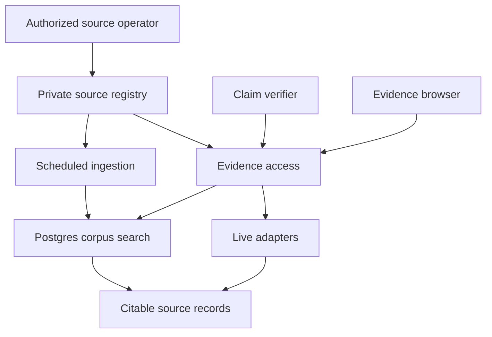

# Source registry and evidence access

**Idea.** Add and disable approved sources without deploying Prawdomat. Give the verifier and operators a shared way to query the data. This proposal would move the evidence allowlist from code into a private registry and requires revising [decision 008](../decisions/008-trusted-source-allowlist.md) before rollout. Use the current catalog as the initial registry contents.

## Architecture

Use private Postgres for the registry, documents and search indexes. Give each publisher a stable ID and each access path its own binding. Google Fact Check can serve multiple publishers. One publisher can have both a live and a corpus binding. Keep tier, evidence or context role, and citation domains with the publisher. Keep adapter configuration and permitted request destinations with the binding. Model route coverage by capability and scope, including required coverage and equivalent alternatives. Include path restrictions where publishers share a host. Store credentials separately. Publish validated revisions atomically and keep an audit history.

## Add or disable a source

- **Add.** Create a draft, select a supported adapter, enter its configuration and test a sample query against the source. Review permissions, sample data, date and citation URL, then activate the revision. An RSS feed, approved document upload or supported JSON response can use an existing adapter. A new protocol or complex mapping calls for a new adapter, deployed once. Keep adapters read-only, validate options at the boundary and check outbound destinations against the approved configuration.
- **Disable.** Mark the publisher or binding inactive. New lookups and ingestion exclude it. Filter corpus queries by active publisher and binding IDs before ranking. Enforce the same eligibility rule on every returned record, including results from a shared aggregator. Recheck active IDs before publishing evidence and inside the transaction that commits an ingestion batch. Scope cached results to the registry revision. Keep historical citations and stored material according to the approved retention policy. Purging stored material is a separate operation.
- **Coverage.** Report unsupported scope when a source is disabled and no equivalent source covers it. Distinguish that from a failing active provider and from a completed lookup with inadequate evidence.

## Freshness and document versions

Treat an uploaded file as a dated snapshot. Record its publication date and any stated effective period. Default to historical use. For a changing source, use the publisher's feed or API when available. Track the last successful refresh and the allowed age for the source. A successful refresh can still return an expired document, so check effective dates separately.

For manual updates, upload a replacement under the same source. Keep versions under the approved retention policy and exclude superseded or expired versions from checks about the present. For a historical claim, select the version that covers the claim date. When current evidence is required, fetch it from an eligible live source or apply the pipeline's failure or abstention rules.

## Query the data

The verifier routes a claim by capability and scope. An operator can use the same evidence access service to inspect records by source, date and query. For example, fetch an exchange rate from the live adapter using a currency and date. Search announcements by keyword and meaning using PostgreSQL full-text search and pgvector. Apply source and date filters before ranking. Both paths return the existing `SourceRecord` evidence format with provenance and a public citation. Keep `GET /api/v1/sources` as the public view of active sources.

Keep the existing `Connector` boundary. The registry supplies active bindings to the evidence access service. Adapters fetch and validate external data. The verifier checks the returned evidence and decides the verdict. API Anything can help prototype an approved live integration during development.

## Alternatives and rollout

A Git-managed profile makes changes reviewable, but each activation requires a deployment. A private registry adds an operator workflow and lets source changes take effect independently. An unrestricted plug-in or URL editor would require the application to trust arbitrary execution or outbound destinations. Use a registry with constrained adapter types.

1. Seed the registry from the current catalog. Prove that disabling a source removes it from route selection, corpus matches and the public source list.
2. Wire one live adapter and one corpus adapter through the same record interface. Prove that both return inspectable citations and that an in-flight fetch cannot publish a disabled result.
3. Add the operator workflow for draft, sample, activate and disable. Add a filtered evidence browser over the shared query service.
