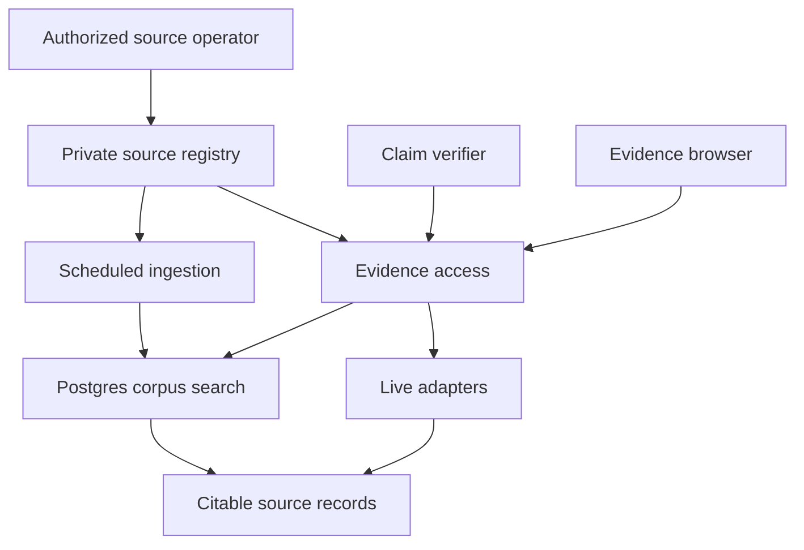

# Source registry and evidence access

How operators manage evidence sources and how Prawdomat finds the right version of a record. Polish translation: [source-platform.pl.md](source-platform.pl.md).

**Idea.** Add and disable approved sources without deploying Prawdomat. Give the verifier and operators a shared way to query the data. This proposal would move the evidence allowlist from code into a private registry and requires reviewing [the allowlist decision](../decisions/008-trusted-source-allowlist.md) and [the configuration decision](../decisions/003-config-in-code.md) before rollout. Use the current catalog as the initial registry contents.

## Architecture

Use the existing Supabase database with server-only registry and corpus tables. Give each publisher a stable ID and each access path its own binding. Google Fact Check can serve multiple publishers. One publisher can have both a live and a corpus binding. Keep tier, evidence or context role, and citation domains with the publisher. Keep adapter configuration and permitted request destinations with the binding. Model route coverage by capability and scope, including required coverage and equivalent alternatives. Include path restrictions where publishers share a host. Keep evidence tier, evidence versus context role, and required-route policy under engineering review. Each binding references credentials managed by the deployment. Publish validated revisions atomically and log the operator and the change. Add authenticated operator identities before enabling writes.

An aggregator has one binding and an explicit link to each approved publisher. An eligible record needs an active publisher, binding, and link. Resolve the public citation URL against approved host and path scopes. Reject unmatched or ambiguous records and validate conflicting scopes before activation. Apply the permissions recorded for that publisher and binding. Derive the evidence tier and origin from the publisher so the same publisher counts once across live records and document versions.

## Add or disable a source

- **Add.** Create a draft, select a supported adapter, enter its configuration and test a sample query against the source. Review permissions, sample data, date and citation URL, then activate the revision. An RSS feed, approved document upload, or supported JSON template can use an existing adapter. JSON templates and their query and field mappings are reviewed in code. A new format calls for a new adapter or template. Keep adapters read-only, validate options before sending a sample request, and reject destinations and redirects outside the approved scope. Accept uploads only after the corpus retention policy is approved and the record has a public canonical publisher URL.
- **Disable.** Mark the publisher or binding inactive. New lookups and ingestion exclude it. Filter corpus queries by active publisher and binding IDs before ranking. Enforce the same eligibility rule on every returned record, including results from a shared aggregator. Pin the registry revision at check start. At response assembly, read the active revision and revalidate the evidence used for each claim, including on cache hits. If a publisher or binding used in the assessment was disabled, discard the affected claim result and return a retryable system state. Serialize the ingestion eligibility check with its commit. Key caches by registry and corpus revisions. If the registry cannot be read at final validation, return a retryable system state for the affected check. A configured deployment must never fall back to the seed catalog. Keep historical citations and stored material according to the approved retention policy. Purging stored material is a separate operation.
- **Coverage.** Report unsupported scope when a source is disabled and no equivalent source covers it. Distinguish that from a failing active provider, stale required data without an eligible replacement, and a completed lookup with inadequate evidence. Stale required data is a system state. Map it to the existing source-unavailable contract.

## Freshness and document versions

Treat an uploaded file as a dated snapshot. A dated statement can establish what a publisher said at the time. A standing-state record, such as a travel advisory, also needs an effective period and a freshness rule based on the publisher update date. Track the last successful sync separately. For a changing source, use the publisher’s feed or API when available.

For manual updates, replace a specific document ID. Index the replacement, then mark it current and supersede the old version in one transaction that also bumps the corpus revision. Pass the claim date to corpus search. Filter by current and effective version for checks about today. For historical checks, find a retained version that covers the claim date. If required evidence has expired, try an equivalent live source or return the stale-data system state.

## Query the data

The verifier routes a claim by capability and scope. An operator can search the corpus by source, date and keyword, or run a sample claim through live connectors to inspect their records. Extend the corpus search interface and service to accept source, binding and claim date filters before ranking. Compare keyword and vector retrieval on Polish evidence before selecting the search strategy. Both paths return the existing `SourceRecord` evidence format with provenance and a public citation. Keep `GET /api/v1/sources` as the public view of active sources.

Keep the existing `Connector` boundary. The registry supplies active bindings to the evidence access service. Adapters fetch and validate external data. The verifier checks the returned evidence and decides the verdict. API Anything can help prototype an approved live integration during development.

## Alternatives and rollout

A Git-managed profile makes changes reviewable, but each activation requires a deployment. A private disable switch for the Git allowlist is the smallest option if immediate shutdown is the only requirement. A private registry adds an operator workflow and lets source changes take effect independently. An unrestricted plug-in or URL editor would require the application to trust arbitrary execution or outbound destinations. Use a registry with constrained adapter types.

1. Seed the registry from the current catalog. Prove that disabling a source removes it from route selection, corpus matches and the public source list.
2. Wire one live adapter and one corpus adapter through the same record interface. Prove that both return inspectable citations and that an in-flight fetch cannot publish a disabled result.
3. Add the operator workflow for draft, sample, activate and disable. Add a filtered evidence browser over the shared query service.
