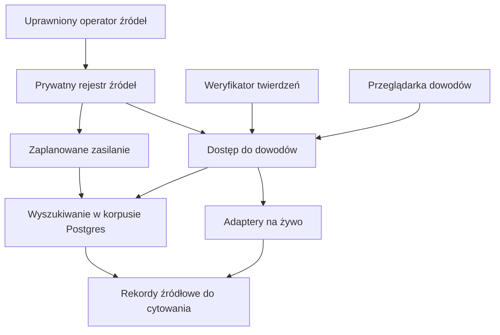

# Rejestr źródeł i dostęp do dowodów

Polskie tłumaczenie [source-platform.md](source-platform.md). Przy rozbieżności obowiązuje wersja angielska, a zmiany wprowadzamy najpierw tam.

Jak operatorzy zarządzają źródłami dowodów i jak Prawdomat znajduje właściwą wersję rekordu.

**Pomysł.** Dodawać i wyłączać zatwierdzone źródła bez wdrażania Prawdomatu. Dać weryfikatorowi i operatorom wspólny sposób odpytywania danych. Propozycja przenosi listę dozwolonych źródeł z kodu do prywatnego rejestru. Przed wdrożeniem trzeba ponownie przejrzeć [decyzję o liście dozwolonych źródeł](../decisions/008-trusted-source-allowlist.md) i [decyzję o konfiguracji](../decisions/003-config-in-code.md). Początkowa zawartość rejestru to obecny katalog.

## Architektura

Używamy istniejącej bazy Supabase z tabelami rejestru i korpusu dostępnymi tylko dla serwera. Każdy wydawca dostaje stały identyfikator, a każda ścieżka dostępu własne powiązanie. Google Fact Check może obsługiwać wielu wydawców. Jeden wydawca może mieć zarówno powiązanie na żywo, jak i powiązanie z korpusem. Poziom wiarygodności, rola (dowód albo kontekst) i domeny cytowań należą do wydawcy. Konfiguracja adaptera i dozwolone adresy zapytań należą do powiązania. Pokrycie tras opisujemy przez zdolność i zakres, łącznie z wymaganym pokryciem i równoważnymi alternatywami. Tam, gdzie wydawcy dzielą host, dodajemy ograniczenia ścieżek. Poziom wiarygodności, rolę dowodu albo kontekstu i zasady tras wymaganych zatwierdza zespół techniczny. Każde powiązanie wskazuje dane uwierzytelniające zarządzane przez wdrożenie. Sprawdzone rewizje publikujemy atomowo i zapisujemy operatora oraz zmianę. Zanim włączymy zapis, dodajemy uwierzytelnione tożsamości operatorów.

Agregator ma jedno powiązanie i jawny link do każdego zatwierdzonego wydawcy. Rekord się kwalifikuje tylko wtedy, gdy aktywni są wydawca, powiązanie i link. Publiczny URL cytowania dopasowujemy do zatwierdzonych zakresów hostów i ścieżek. Rekordy niedopasowane lub niejednoznaczne odrzucamy, a sprzeczne zakresy wykrywamy przed aktywacją. Stosujemy uprawnienia zapisane dla danego wydawcy i powiązania. Poziom wiarygodności i pochodzenie wyprowadzamy z wydawcy, więc ten sam wydawca liczy się raz w rekordach na żywo i w wersjach dokumentów.

## Dodawanie i wyłączanie źródła

- **Dodanie.** Operator tworzy szkic, wybiera obsługiwany adapter, wpisuje jego konfigurację i wysyła próbne zapytanie do źródła. Sprawdza uprawnienia, przykładowe dane, datę i URL cytowania, a potem aktywuje rewizję. Kanał RSS, zatwierdzony wgrany dokument albo obsługiwany szablon JSON korzystają z istniejącego adaptera. Szablony JSON oraz ich mapowania zapytań i pól przeglądamy w kodzie. Nowy format wymaga nowego adaptera albo szablonu. Adaptery tylko czytają dane. Opcje sprawdzamy przed wysłaniem próbnego zapytania, a adresy i przekierowania spoza zatwierdzonego zakresu odrzucamy. Wgrane pliki przyjmujemy dopiero po zatwierdzeniu polityki retencji korpusu i tylko wtedy, gdy rekord ma publiczny, kanoniczny URL wydawcy.
- **Wyłączenie.** Operator oznacza wydawcę albo powiązanie jako nieaktywne. Nowe wyszukiwania i zasilanie je pomijają. Zapytania do korpusu filtrujemy po identyfikatorach aktywnych wydawców i powiązań przed rankingiem. Tę samą zasadę stosujemy do każdego zwróconego rekordu, także z współdzielonego agregatora. Na starcie sprawdzania przypinamy rewizję rejestru. Przy składaniu odpowiedzi odczytujemy aktywną rewizję i ponownie sprawdzamy dowody użyte dla każdego twierdzenia, również przy trafieniu w cache. Jeśli wydawcę lub powiązanie użyte w ocenie wyłączono, odrzucamy wynik tego twierdzenia i zwracamy stan systemowy z prośbą o ponowienie. Sprawdzenie kwalifikacji przy zasilaniu wykonujemy szeregowo razem z zapisem. Klucze cache zawierają rewizje rejestru i korpusu. Jeśli przy końcowej walidacji nie da się odczytać rejestru, zwracamy dla tego sprawdzenia stan systemowy z prośbą o ponowienie. Skonfigurowane wdrożenie nigdy nie wraca do katalogu startowego. Historyczne cytowania i przechowywane materiały trzymamy zgodnie z zatwierdzoną polityką retencji. Usuwanie przechowywanych materiałów to osobna operacja.
- **Pokrycie.** Gdy źródło jest wyłączone i żadne równoważne go nie zastępuje, zgłaszamy nieobsługiwany zakres. Odróżniamy to od awarii aktywnego dostawcy, od nieaktualnych wymaganych danych bez kwalifikującego się zamiennika i od zakończonego wyszukiwania, które nie dało wystarczających dowodów. Nieaktualne wymagane dane to stan systemowy, który mapujemy na istniejący stan „źródło niedostępne” z kontraktu.

## Aktualność i wersje dokumentów

Wgrany plik traktujemy jako datowaną migawkę. Datowana wypowiedź pokazuje, co wydawca powiedział w danym momencie. Rekord o stanie bieżącym, np. ostrzeżenie dla podróżnych, potrzebuje też okresu obowiązywania i reguły aktualności opartej na dacie aktualizacji u wydawcy. Ostatnią udaną synchronizację śledzimy osobno. Dla źródła, które się zmienia, używamy kanału lub API wydawcy, jeśli są dostępne.

Przy ręcznej aktualizacji zastępujemy konkretny identyfikator dokumentu. Indeksujemy zamiennik, a potem w jednej transakcji oznaczamy go jako bieżący, zastępujemy starą wersję i podbijamy rewizję korpusu. Do wyszukiwania w korpusie przekazujemy datę twierdzenia. Dla twierdzeń o stanie dzisiejszym filtrujemy po wersji bieżącej i obowiązującej. Dla twierdzeń historycznych szukamy zachowanej wersji, która obejmuje datę twierdzenia. Jeśli wymagany dowód wygasł, próbujemy równoważnego źródła na żywo albo zwracamy stan systemowy dla nieaktualnych danych.

## Odpytywanie danych

Weryfikator kieruje twierdzenie według zdolności i zakresu. Operator może przeszukiwać korpus po źródle, dacie i słowie kluczowym albo przepuścić przykładowe twierdzenie przez konektory na żywo i obejrzeć ich rekordy. Interfejs i usługę wyszukiwania w korpusie rozszerzamy o filtry źródła, powiązania i daty twierdzenia, stosowane przed rankingiem. Zanim wybierzemy strategię wyszukiwania, porównujemy wyszukiwanie po słowach kluczowych i wektorowe na polskich dowodach. Obie ścieżki zwracają istniejący format dowodu `SourceRecord` z pochodzeniem i publicznym cytowaniem. `GET /api/v1/sources` pozostaje publicznym widokiem aktywnych źródeł.

Zachowujemy istniejącą granicę `Connector`. Rejestr przekazuje aktywne powiązania usłudze dostępu do dowodów. Adaptery pobierają i sprawdzają dane zewnętrzne. Weryfikator sprawdza zwrócone dowody i decyduje o werdykcie. API Anything może pomóc w prototypie zatwierdzonej integracji na żywo w trakcie developmentu.

## Alternatywy i kolejność wdrożenia

Profil zarządzany w Git pozwala przeglądać zmiany, ale każda aktywacja wymaga wdrożenia. Prywatny wyłącznik dla listy w Git to najmniejsza opcja, jeśli wystarczy samo natychmiastowe wyłączanie. Prywatny rejestr dodaje proces pracy operatora i pozwala zmieniać źródła niezależnie od wdrożeń. Nieograniczony system wtyczek albo edytor URL-i wymagałby, żeby aplikacja ufała dowolnemu kodowi lub dowolnym adresom docelowym. Dlatego wybieramy rejestr z ograniczonym zestawem typów adapterów.

1. Zasilić rejestr obecnym katalogiem. Pokazać, że wyłączenie źródła usuwa je z wyboru tras, z dopasowań w korpusie i z publicznej listy źródeł.
2. Podłączyć jeden adapter na żywo i jeden adapter korpusu przez ten sam interfejs rekordów. Pokazać, że oba zwracają cytowania, które da się sprawdzić, i że trwające pobieranie nie opublikuje wyniku z wyłączonego źródła.
3. Dodać proces operatora: szkic, próbka, aktywacja i wyłączenie. Dodać przeglądarkę dowodów z filtrami, opartą na wspólnej usłudze zapytań.
