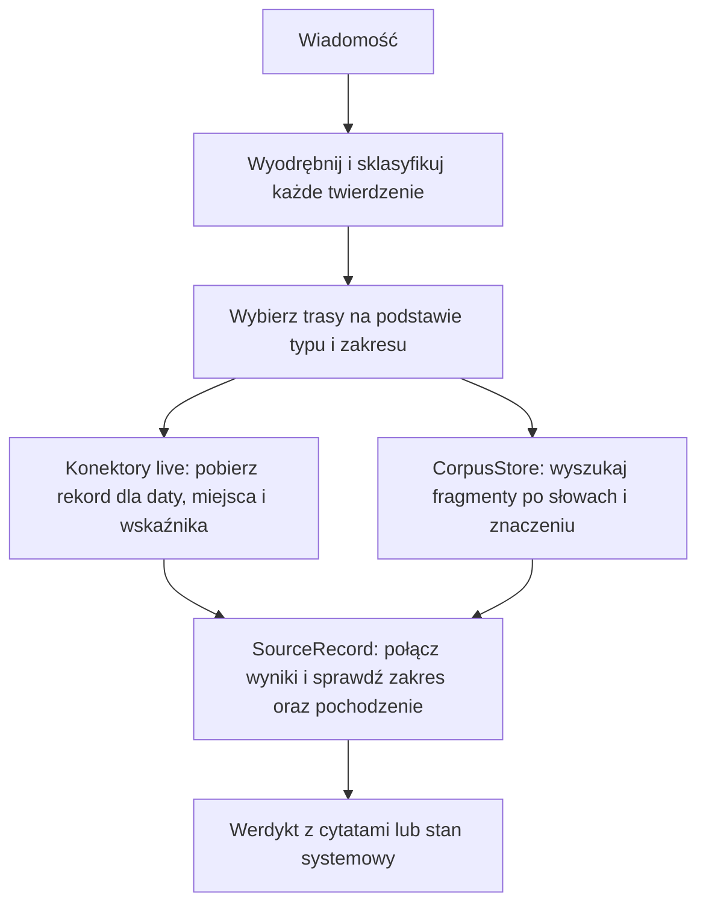

# Plan integracji bazy wektorowej
Plan wpięcia istniejącego prototypu PostgreSQL + pgvector do Prawdomatu przy minimalnych zmianach.

Status: Etap 0 i podstawowy Etap 1 są zaimplementowane lokalnie (tylko localhost); lista braków w [Co zostało](#co-zostało-stan-2026-11-21). Pełny test wymaga zainstalowania
zależności Python oraz Deno/Bun zgodnie z README.

## Stan obecny

- `scripts/ingest_corpus.py` i `scripts/retrieval.py` tworzą oraz przeszukują `documents`/`chunks` w PostgreSQL z `pgvector`.
- `scripts/api.py` wystawia `/health` i `/search`; zwraca literalny fragment tekstu, offsety, URL, tytuł, daty i score.
- `packages/core` ma już właściwy punkt rozszerzenia: `CorpusStore.search()` i `CorpusStore.upsert()`.
- `corpusSearch` jest już podłączony do `CONNECTORS`. Bez skonfigurowanego adresu serwisu używa `MemoryCorpusStore`, który wyszukuje po wspólnych słowach.
- Kontrakt `/api/v1/check` nie wymaga zmiany. Korpus jest trasą opcjonalną, więc brak bazy nie może stać się werdyktem.

## Propozycja: dobór źródeł do twierdzenia i mały korpus

**Idea.** Wyodrębnij z wiadomości osobne twierdzenia. Każde skieruj do istniejących konektorów na podstawie rodzaju twierdzenia, podmiotu, miejsca i okresu. Katalog w kodzie może opisać, jakie dane zwraca każde źródło i kiedy je wywołać. Na przykład dla kursu waluty z danego dnia pobierz odpowiedni rekord z NBP. Wyszukiwanie wektorowe po opisach źródeł warto sprawdzić, gdy katalog urośnie. Może podpowiadać dodatkowe źródła. Reguły w kodzie wciąż uruchamiają wymagane konektory.

W pgvector indeksuj wybrane komunikaty, dokumenty i fact-checki, dla których potrzebujemy wyszukiwania po treści i mamy prawo do przechowywania. Zapisuj fragmenty wraz z adresem, wydawcą i datą. Oceniaj twierdzenie na podstawie pobranego rekordu lub fragmentu. Zakres korpusu demonstracyjnego wynika z [wymagań organizatora](../hackathon/task-brief.md).

Przykład. Wiadomość „Euro kosztowało 4,50 zł tego dnia, a NBP zapowiedział zmianę zasad” daje dwa twierdzenia. Konektor NBP pobiera kurs EUR z odpowiedniego dnia. `CorpusStore` szuka komunikatu NBP, a ocena sprawdza cytat i datę. Gdy obie trasy pasują do jednego twierdzenia, uruchom je równolegle i usuń powtórzenia tego samego materiału przed oceną. Gdy wymagany konektor jest niedostępny, zastosuj reguły [obsługi awarii tras](verification-pipeline.md#3-run-relevant-evidence-routes).

### API Anything jako pomoc przy budowie konektora

**Idea.** [API Anything](https://github.com/goodnight000/api-anything/tree/cd8d773d6617df07dc473598b67dec4d612276bc) odtwarza wybrane zapytania używane przez frontend witryny. Może pomóc przy budowie konektora do zatwierdzonego źródła, które zezwala na automatyczny odczyt i nie ma udokumentowanego API. Wdrożenie powinno używać sprawdzonego, wersjonowanego odczytu. Konektor waliduje pola odpowiedzi i mapuje je na `SourceRecord` z publicznym linkiem. [Interfejs hosta](https://github.com/goodnight000/api-anything/blob/cd8d773d6617df07dc473598b67dec4d612276bc/docs/HOST.md) opisuje schemat wyniku, ale go nie egzekwuje. Dobór źródła i indeksowanie dokumentów pozostają po stronie Prawdomatu. Ocena opiera się na dokumentacji i kodzie interfejsu hosta. Nie wykonano prób na źródłach projektu.

## Zrealizowany wariant: cienki adapter HTTP

Python pozostaje osobnym retrieval service, a embedder nie został przepisany do Deno.

1. Dodać `HttpCorpusStore` w `packages/core/src/store/` implementujący istniejący `CorpusStore`.
2. Adapter wysyła `POST {PRAWDOWID_RETRIEVAL_URL}/search` z połączonymi zapytaniami (`claim.text` + `search_queries_pl`), `k=5`.
3. Wyniki mapuje na istniejący `SourceRecord`: `source_id` z `document_id/chunk_id`, `route: "corpus"`, `tier: "official"` tylko dla jawnie skonfigurowanych źródeł, literalny `quoted_text` jako `text`, oraz metadane dokumentu.
4. `apps/api/main.ts` wybiera `HttpCorpusStore`, gdy ustawiono URL; w przeciwnym razie zostawia `MemoryCorpusStore`. To jest jedyna zmiana wiringowa aplikacji.
5. Dodać timeout, abort przez `ctx.signal`, walidację odpowiedzi i mapowanie błędów na `ConnectorError`/status opcjonalnej trasy. Awaria retrievalu ma dać ograniczenie techniczne, nie werdykt.
6. Dodać `PRAWDOWID_RETRIEVAL_URL` do `.env.example` jako ustawienie niebędące sekretem oraz `/api/v1/health` z informacją `corpus: configured/unconfigured` bez ujawniania DSN.

## Kolejność wdrożenia

### Etap 0 — uruchamialność prototypu

- `docker-compose.yml` jest już w repozytorium.
- Naprawić test/ścieżkę health w Python API (`HTTPException` nie jest importowane).
- Uruchomić ingest 21 dokumentów i test kontraktu `/search`.

### Etap 1 — integracja bez zmiany pipeline’u

- Dodać adapter `HttpCorpusStore` i testy z fake `fetch`.
- Włączyć go przez zmienną środowiskową; default pozostaje in-memory.
- Przetestować: hit, pusty wynik, timeout, 500 serwisu, błędny JSON, literalny cytat i zachowanie bez konfiguracji.

### Etap 2 — jakość i bezpieczeństwo dowodu

- Nie uznawać samego score za dowód; model nadal ocenia stance, a kod nadal waliduje cytat i zakres.
- Dodać jawne mapowanie allowlisty źródeł, zamiast ufać `publisher` zwróconemu przez usługę.
- Dodać `embedding_model_id`, threshold i snapshot indeksu do diagnostyki/replay, nie do publicznego kontraktu.
- Porównać benchmark keyword-only vs vector na istniejących evalach; dopiero wynik uzasadnia włączenie retrievalu jako domyślnego.

### Etap 3 — docelowe przeniesienie do Supabase

Jeżeli osobny Python service będzie problemem operacyjnym, przenieść tabele do `corpus` w Supabase i wystawić prywatną funkcję/RPC retrievalu. Wtedy adapter `CorpusStore` pozostaje taki sam, a zmienia się tylko jego implementacja. `packages/core` nie powinien zależeć od biblioteki Python.

## Dlaczego nie zmieniać teraz core

- Interfejs `CorpusStore` już izoluje storage.
- `corpusSearch` już działa jako opcjonalny connector.
- `SourceRecord` jest wspólnym formatem dla oceny, cytatów i logowania.
- Bezpośrednie połączenie Deno → PostgreSQL zwiększyłoby zależności, sekrety i ryzyko migracji, a nie dałoby teraz przewagi jakościowej.
- Osobny FastAPI service jest kompromisem przejściowym; Supabase pozostaje docelowym miejscem, zgodnie z istniejącą architekturą.

## Otwarte decyzje przed implementacją

- Czy środowisko docelowe może uruchamiać osobny kontener Python, czy od razu wymagany jest Supabase/Edge Function?
- Jaki poziom źródeł ma mieć `policja.pl` w allowliście (`official` vs osobna polityka źródeł instytucjonalnych)?
- Czy publiczny corpus może przechowywać pełne teksty przy obecnym `license_status: conditional` i jaką przyjąć retencję?
- Czy po benchmarku wdrażamy samo vector search, czy hybrydę FTS + vector/RRF?

## Co zostało (stan 2026-11-21)

Przegląd kodu po commicie `2e32f15` (Fakt = sprawdzone w repo).

1. **Hosting** (Fakt): serwis działa tylko na `127.0.0.1:8000`, więc API na Deno Deploy go nie osiągnie. Trzeba wystawić Postgres + FastAPI (np. Postgres w Supabase w schemacie `corpus`, FastAPI w małym kontenerze) albo przejść od razu do Etapu 3.
2. **Rozmiar korpusu** (Fakt): 21 dokumentów z 1 domeny (`policja.pl`; 2 kanały RSS, 2026-07-01..2026-11-21, ~82 tys. znaków, głównie komunikaty PR: turnieje, kampanie, zatrzymania, więc mała wartość dla fact-checkingu) wobec wymogu ≥100 dokumentów, ≥10 domen, ≥2 typów ([compliance-matrix](../hackathon/compliance-matrix.md)). W repo nie ma kolektorów (scraper/RSS), które wyprodukowały `data/corpus/policja-clean.jsonl`; brakują źródła z [planu korpusu](data-sources-research.md#recommended-corpus-plan-24h-mvp): CERT, gov.pl RCB/GIS/MSZ, IMGW, ELI, EUR-Lex, Odyseusz, ClaimReview z Google FCT.
3. **EUvsDisinfo osobno** (Fakt): `euvsdisinfo-pull.ts` istnieje, ale `KnownIncidentStore` nie ma backendu w bazie. Sprawy EUvsDisinfo nie mogą trafić do tabeli `chunks`, bo `corpusSearch` cytowałby je jako dowód (kontekst, nie dowód: [euvsdisinfo-mcp](euvsdisinfo-mcp.md)).
4. **Adapter `HttpCorpusStore`** (Fakt): `tier: "official"` jest zaszyty dla każdego trafienia (brak mapowania przez `sources/catalog.ts`, Etap 2); brak timeoutu i `ctx.signal` (krok 5 nie zrobiony); zapytania sklejane w jeden string zamiast osobnych wyszukiwań i scalenia; `/api/v1/health` publicznie zwraca `retrieval_url`.
5. **Polityka korpusu** (Fakt): pełne teksty z `license_status: conditional` bez spisanej podstawy prawnej i retencji: pozycja ❌ w compliance-matrix.
6. **Ewaluacja** (Fakt): brak przypadków w `eval/` zależnych od korpusu i brak porównania keyword vs vector; próg `0.82` dla `multilingual-e5-small` nie był strojony.
7. **Odświeżanie** (Idea): jednorazowy snapshot z `retrieved_at` wystarczy na hackathon; codzienny re-ingest RSS później.
