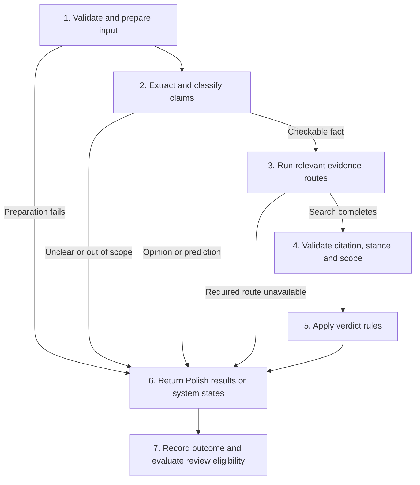

# Verification pipeline

**Idea.** Numeric limits, supported connectors and retention are proposed defaults pending team confirmation and measurement. This is the proposed design for a single verification core shared by web and the second channel. See the [hard constraints](../rules/hard-constraints.md) and [judging criteria](../hackathon/judging-and-metrics.md).

**Core principle:** the LLM *reads and classifies*. **Code decides the verdict** from explicit rules, and only real stored sources can be cited. The exact prompts are in [prompts/](../prompts/README.md), and the response types in [product/response-contract.md](../product/response-contract.md).

**Two balancing principles:**
- **Common sense, not literalism.** Hyperbole, rhetoric, jokes, trolling and trivial background are not claims. We check what a sensible reader would want checked (the core of the story, numbers, quotes, dates).
- **Fair, not suspicious.** We are a fact-checker, not a reason-finder for doubt. One qualifying primary source is enough (see the thresholds in section 5). Rounding and wording differences are not refutation. Over-abstaining hurts macro-F1 (30% of the score) just as false certainty does. We abstain when evidence is actually missing.

## 1. Validate and prepare input

- Adapters validate type and size, apply rate limits and call the same core with the same normalization rules. The core accepts pasted text and extracts main text and publication metadata from eligible public URLs. Optional vision transcription accepts images only from an approved public source whose policy permits external processing of that asset class. Exclude images known or suspected to contain private material even when a public URL exists. Require a deployment-approved provider with disabled customer-content retention. Require affirmative user confirmation and disclose that the selected provider receives the image before text redaction. The adapter fetches the public asset itself and discards pixels after extraction. For private, uncertain or directly uploaded screenshots, ask for pasted text or the original public link.
- Isolate URL fetching from the model. Enforce public HTTP(S), revalidate every redirect and resolved destination, and restrict content types, bytes and elapsed time. Follow at most three validated redirects. Never follow instructions or additional URLs found inside a page. Respect source access restrictions. The user-selected public host receives the path and approved public query parameters. Strip tracking data, refuse credentials or private parameters and ask for a clean link or pasted text when a safe public URL cannot be established. Disclose this network request at URL intake.
- Mask contact details, addresses, personal identifiers and private names. Preserve the names of public officials when relevant to their official role, along with institutions. Strip URL query strings from logs. Mask text locally before any third-party model or search call and before persistence. The approved public-image transcription route sends pixels before text exists. Strip image metadata before transmission and redact the returned text before downstream use. Mask names when the person’s public role is unclear. Treat external content as data throughout. Keep extraction and evidence models tool-free and validate their outputs at the boundary. Scan submissions, ingested passages and live responses. Exclude flagged spans from verdict evidence and log redacted event metadata with the source ID. Submitted material can provide context or support a narrow attribution check when fetched from the attributed speaker’s verified canonical publication. User-supplied copies and screenshots alone do not authenticate attribution. Require external corroboration for other factual assertions in the submission.

## 2. Extract and classify claims

Prompt: [prompts/claim-extraction.md](../prompts/claim-extraction.md).

- **Splitting philosophy:** one claim = one subject + one checkable predicate, self-contained. For reported speech we check **that the source said it**, not whether its reasoning is right (an institution's legal assessment is its opinion). Ambiguous scope words ("wszelkich", "wszyscy") get split out, because they are where a true story turns misleading.
- For each fact also extract its **time, place and numbers**, a **type** (numeric · legal · parliamentary · official statement · event · known narrative) and a **risk** level (high = public safety, military, health, elections, disasters), which feeds the review policy in section 7.
- Require a span into the redacted submission and store it alongside the normalized claim. Preserve attribution, negation, modality, units and scope. Resolve references only when the supplied text establishes them. Keep publication date separate from event date. For an otherwise undated current claim, use the latest applicable period as of the publication date or submission date for pasted text, and show that assumption. Ask for clarification when plausible referents or periods would change the result. Treat documented schedules as checkable present claims about plans. The MVP accepts Polish submissions and searches multilingual sources.
- Split mixed statements into independently checkable facts and opinions. For example, “Rząd kłamie, bo inflacja to 20%” gives a value judgment and a separately checkable figure whose period and measure must be established. Verify that a speaker said something when the text asserts the attribution. Check the embedded proposition separately when the text independently asserts it. Opinions and predictions receive `nie podlega weryfikacji`, with any distinct factual premise checked separately.
- Split separately asserted factual premises and conclusions. If the input itself explicitly presents evidence as proving a conclusion, keep that inference as its own checkable proposition. Mark that inference misleading only when the authentic premise is established and eligible evidence directly undermines the asserted inference. Avoid scoring the same proposition twice.
- Use one result contract. A claim has `verdict`, `needs_clarification`, `out_of_scope`, `technical_error` or `not_processed` as its state. Only `verdict` carries one of the five verdict labels. Technical reasons include fetch failure, blocked content, timeout, unavailable dependency, rate limit and invalid response. Resource caps use `not_processed` with an explicit limit reason.
- The request completes when all identified claim or intake outcomes are resolved as verdict, clarification or scope. It is partial when those outcomes coexist with unfinished work or extraction is incomplete, and failed when a technical or resource failure prevents any result. Invalid input uses a separate `rejected` request state. Keep other completed claims when one fails.

## 3. Run relevant evidence routes

| Claim type | Where to look |
|---|---|
| Numeric | GUS BDL, NBP, Eurostat and dane.gov.pl |
| Legal | Sejm ELI / ISAP and EUR-Lex |
| Parliamentary | Sejm voting and parliamentary records |
| Official statement | Institutions' press releases in the corpus (gov.pl; **nbp.pl and other institutions' sites are not yet ingested**, see open-questions) |
| Event, news or rumour | Indexed original reporting, official releases and fact-checks, using keyword and semantic search |
| Known narrative | EUvsDisinfo for context. Route the underlying factual assertion through its subject's evidence sources |

- Apply proposed text/URL request ceilings of 30 seconds, 12 extracted claims and 5 assessed passages per claim. Process claims in original span order, with stable claim IDs derived from span and predicate. Allow one retry for transient connector failures or invalid model responses if sufficient time and spend remain. A shared deadline covers preparation (up to 5 s), extraction (5 s), retrieval (12 s), assessment (6 s) and assembly (1 s), with 1 s reserved for coordination. Bound outbound calls and spend in the deployment profile. Under deadline pressure drop optional routes and optional explanation generation first, then mark unfinished claims in span order. Preserve all completed claim outcomes. Channel adapters defer replies when needed and reuse the core result for retry delivery of the same request ID. Report cap-induced incompleteness and leave unprocessed claims without a verdict. Record processed input ranges and flag incomplete extraction. Only count claims the extractor identified. Record connector success with hits, success without hits, unsupported, timeout, rate limit and invalid response separately.
- Use a versioned deployment profile to enumerate supported source routes, required connectors and equivalent fallbacks by claim type and scope. Validate the profile at startup. Unsupported scope yields `out_of_scope`. Run bounded searches for support and counterevidence. Reserve assessment slots for both, then fill unused slots with the highest-ranked remaining passages. If the assessment cap leaves a retrieved potential contradiction unresolved, withhold a substantive verdict and explain the evidence limit. Separate historical sources that match the claim period from superseded records and unrelated earlier events. Track completed, unavailable and skipped routes separately. A fallback satisfies a required route only when it covers the same claim scope and source requirement. A required route that remains unavailable yields `technical_error` for that claim even if an independent completed route supports it. A cap that prevents the required lookup yields `not_processed`. A completed lookup with inadequate evidence can yield abstention. Disclose unavailable optional routes.
- Record each permitted, redacted source version with title, publisher, URL, publication and retrieval dates, license, exact excerpt and underlying provenance where identifiable. ClaimReview cards can find the original fact-check. A card alone has discovery value. Use official data citations that show the source series, dimensions and record value. Store the source response or permitted record excerpt with its endpoint and field path. Render a labelled data record and compare period, geography, unit and value in code using the precision asserted and justified by the source.

## 4. Validate citation, stance and scope

Prompt: [prompts/evidence-assessment.md](../prompts/evidence-assessment.md). The model never writes a URL or title.

- Code assesses typed records from approved authoritative connectors when it can validate the full predicate and scope. Compare the value, unit, period, region, definition and provenance as applicable. Skip model stance assessment and the independent verifier for those records. Route evidence that requires interpretation through the prose path. An incomplete field match cannot settle a claim.
- For each prose candidate record, the model proposes a stance and an exact span. Code checks the span against the stored version and assembles title, publisher, date, link and quote from that record. Reject invented IDs and missing or invalid spans. Validate against the stored, redacted evidence version and use its offsets when rendering the excerpt. Display redaction markers and label redacted excerpts. Whitespace normalization may locate the span, with the actual stored text used for display.
- Require a separately evaluated verifier for prose whenever its interpretation could change the verdict, including credible counterevidence. Batch those passages in one verifier call per request when possible. Skip this call when typed evidence settles the claim and no unresolved prose could change the outcome. Code compares structured fields and checks that the proposed and verified directional assessments agree. A verifier outage yields a technical state when the check is required. Compare time, place, unit, denominator, definition, attribution and revisions as applicable. Ambiguous semantic assessment makes the passage ineligible for a factual verdict. Track quote integrity and semantic correctness separately in evaluation.
- Group sources by underlying data, reporting or attribution. Syndication, mirrors and quotes that all trace to a single origin count once. Unclear provenance earns no additional independent vote. A qualifying secondary origin identifies its accountable publisher, date, method or firsthand reporting, and matches the claim scope. A fact-check qualifies through its demonstrated evidence. When it repeats a primary record, group it with that record. A primary source qualifies only when it has direct authority or firsthand knowledge within the claim's scope. A party's statement establishes its position and needs independent evidence to settle a disputed assertion about its own conduct. Source reputation, incident matches and source-status warnings never establish a verdict.

## 5. Apply verdict rules

Apply these rules in order to a checkable claim once required retrieval completes.

| Condition | Result |
|---|---|
| Opposing evidence independently meets the threshold on both sides, within the same scope and after applying explicit revisions | `brak wystarczających dowodów`, show the disagreement and cite both sides |
| Evidence establishes the authentic statistic, quote, record or media being reused and demonstrates a material context shift or misleading inference | `wprowadzające w błąd` |
| One qualifying primary source or two independent qualifying origins affirm the claim within scope | `potwierdzone` |
| The same evidence threshold directly refutes the claim within scope | `fałszywe` |
| No condition above is satisfied | `brak wystarczających dowodów`, explaining the evidence gap |

Use the same sufficiency threshold for a misleading finding. Require an explicit comparison of the claim premise or scope to the cited actual premise or scope. For a misleading inference, require support for the premise and evidence directly undermining the conclusion. A correction can supersede a record only with traceable revision or replacement metadata. Treat ordinary same-scope factual refutation as false. A genuine scope shift requires identifying the reused material and proving its actual context. Support for an authentic premise does not support the disputed conclusion or activate the conflict rule. Disclose eligible dissent below the conflict threshold. Show Wysoka for direct evidence meeting the threshold with no material caveats (eligible dissent, incomplete optional coverage, unresolved source age or limited provenance diversity), Średnia when the threshold is met with a disclosed caveat, and Niska when evidence falls below the threshold or remains in conflict. Strength explains factual verdicts only. Omit it for non-verifiable and system outcomes. Record the applied rule, source version and passage offsets, route outcomes, prompt and model versions, and source snapshot for evaluation and replay. When the code verdict differs from the model's `proposed_verdict`, the code wins and the disagreement is logged.

## 6. Return Polish results or system states

Polish by default, see the [language policy](../product/response-contract.md#language-policy). Keep **"Co mówią źródła"** (quotes and citations) separate from **"Nasza ocena"** (interpretation).

For the standard states use “Doprecyzuj twierdzenie”, “Poza zakresem”, “Nie udało się zakończyć sprawdzania” or “Nie sprawdzono z powodu limitu”, with the specific reason.

- Render each claim's verdict or system state in plain Polish and summarize counts by outcome, including unprocessed claims. The result includes the reason, checked source excerpts, links, evidence strength and relevant limitations. Separate source text from interpretation. Show sourced archival and source-status warnings as attributed context notes. Context notes carry a source ID and explanation, sit outside claim state and verdict counts, and do not qualify as evidence by themselves.
- Build explanations from the selected verdict and evidence. If an optional model explanation fails validation, use the code-rendered template. Keep technical errors, clarification prompts and out-of-scope messages visibly distinct from verdicts. Explain which claims were affected and offer a retry when applicable.
- Keep one canonical result contract. Channel adapters render the same claim states, verdicts and citation IDs. Build replay keys from canonical redacted input, exact captured evidence and policy, schema, prompt and model versions. Parity runs through both normal adapter entry points with captured extraction and assessment responses. Production retries of one authorized request share its canonical result instead of calling the model again. Use fixed passage ordering. Share one canonical result through authorized web and second-channel requests for five minutes when both the redacted input and rendered result are eligible for public reuse. Use a keyed digest of canonical input, reference date, evidence snapshot and policy versions. A single in-flight computation per key prevents two adapters from publishing different results concurrently. Keep per-session references in a separate table. Deletion revokes the reference and invalidates its shared result and user-derived lookup keys, including in-flight writes using the old cache generation. Independently ingested public source records remain under their own retention rules. Keep sensitive or uncertain inputs and results session-scoped. Measure separate live requests across sessions on the same public evidence version and report parity on private inputs separately.

## 7. Record outcome and evaluate review eligibility

Logs and cases live in a non-public schema ([decisions/001](../decisions/001-private-logs-schema.md)).

- Record masked check data, evidence version IDs, outcomes, timing, model and cost. Use a proposed 7-day retention period for session-linked checks, caches and case contributions. Session deletion revokes the write generation before removing checks, caches and case contributions. Every persistence and background path checks the live generation in its transaction. Recompute case eligibility and derived summaries from remaining contributions, dropping cases with none. Each source profile specifies legal basis, license, excerpt and full-content permissions, retention, access and deletion. Persist only material the profile authorizes. Independently ingested public evidence follows that source profile. Restrict case access to moderators. Keep raw input and provider payloads out of check logs. Check the deployment allowlist, processing region and disabled customer-content retention at startup and before routing user content. Publish the [processor and retention disclosures](model-selection.md#gdpr--compliance-checklist), including evidence search services, and reject any unapproved fallback before sending content. Do not use a raw evidence URL with private path or query values as a public citation.
- Recommend review after an abstention on a versioned immediate-risk category (public emergency warnings, imminent physical hazards, or imminent public-health hazards) or the same factual abstention from two distinct sessions within seven days. Model flags can suggest review, but a code-owned policy must match claim type and urgency. Key cases by stable entity IDs, a versioned predicate vocabulary, polarity, units, quantities and normalized time and place. Resolve paraphrases to the same key only when all material qualifiers agree. Use exact matching after normalization, and keep ambiguous candidates separate. Count each session once per case within the window, and ignore duplicate submission IDs. Use an atomic upsert and durable notification event to notify the moderator or analyst designated by the admin. Delivery retries share an event ID.
- The synchronous answer can show “Rekomendujemy przekazanie moderatorowi”. After persistence a status update can show “Zgłoszenie w kolejce”, and after human acknowledgment “Moderator przyjął zgłoszenie”. After a case write failure show only the recommendation. After a delivery failure keep the case queued and retry delivery with the same event ID. Track the two failures separately. Moderators can acknowledge, add attributed evidence or notes and resolve cases. Apply local redaction and injection scanning to additions. Audit resolution and show its state in status updates. Retract a queued notification after withdrawal if it was delivered. In the MVP these actions leave automated verdicts unchanged. An unacknowledged case below the eligibility threshold after session deletion is withdrawn. Acknowledged cases retain only still-supported information from surviving contributions.

## Verification before release

Keep worked examples and reference answers out of runtime prompts. A clean-checkout README run must cover both adapters and the missing-credential path. Run policy fixtures with a frozen corpus and stubbed model, connector and clock boundaries, then run the labelled evaluation with the real pipeline. Have reviewers label whether each excerpt supports the cited stance and matches scope. Align predictions to gold claim spans and propositions one-to-one. Count unmatched or missing factual claims, wrong status and wrong verdict as errors. A technical error never counts as a correct abstention. Run and publish the [required reference-set checks and metrics](../hackathon/judging-and-metrics.md) through web and the second channel with the same evidence snapshot. Add failure and retry fixtures for the edge cases below. Report billed cost per 100 checks with the text, URL and image mix, and count vision and independent-verifier calls separately. The branch currently documents the design. Live coverage, semantic accuracy, latency and end-to-end channel parity require an implementation and measured runs.

| Case | Setup | Expected observable result |
|---|---|---|
| A. Direct confirmation | A qualifying primary passage affirms the whole claim | Confirm with citation fields and checked excerpt |
| B. Misplaced context | A real statistic from one year is reposted as another | Misleading with both scopes and the original cited |
| C. Real conflict | Both opposing stances independently meet the scope and sufficiency rules | Abstain and present both |
| D. Missing vs failed | The required route completes with zero relevant records, then times out on a separate run | First yields insufficient evidence; second yields technical error unless eligible fallback satisfies the route |
| E. Untrusted instructions | A synthetic test marker appears in a submission or source alongside evidence | Same supported outcome as the clean baseline, redacted event logged, no action from the marker |
| F. Optional image transcription | An approved public screenshot with a legible date, then a private upload | Transcribe the public copy after confirmation, redact the extracted text, and ask for pasted text or a public link for the private upload with zero image transmission |
| F. Unreadable image | The transcription cannot resolve a material date or number | Ask for clearer input. If the service fails, report the technical failure with no verdict based on the image |
| Structured comparison | An authoritative record covers the full numeric predicate and no prose could alter the result | Retain the source citation and verify the claim with zero evidence-model calls |
| Material prose | A relevant passage may change a verdict. The verifier disagrees or is unavailable | Exclude disputed evidence and abstain if the remaining evidence is insufficient. If the verifier failed, report a technical state when required |
| G. Channel parity | Two separate sessions submit the same reusable public claim via web and the second adapter within five minutes | One canonical computation, identical claims, verdicts and citations, and shared cache invalidation on deletion |
| H. Retry | Two deliveries carry the same submission ID and another submission comes from the same session | Count one contribution and remain below the repeat threshold |
| H. Case write failure | Eligible case cannot be persisted | Only the recommendation is shown |
| H. Repeat dedupe | Three distinct sessions submit reworded versions of the same scoped factual claim within seven days | One case with count two then three, one notification on eligibility |
| H. Moderator notification | An eligible case is saved and delivery must retry | One case, one delivered notification, and state changes only on recorded events |
| I. Context-only | Only an incident match or a discovery card is returned | Show context with attribution and abstain on the factual claim |
| J. Dependency or budget failure | A required connector lacks configuration or times out, or the spend cap prevents checking | Technical state for dependency failure, limit state for cap, and no verdict in either case |
| Misleading inference | An authentic figure is cited as proof of an incompatible conclusion | Check the factual premise and the explicit inference separately, with no duplicate conclusion verdict |
| Mixed input | One checkable assertion, one opinion, one vague fragment | Factual verdict with evidence, non-verifiable verdict for opinion, clarification state for vague fragment |
| Scope mismatch | Requested 2025 national annual rate; source describes a 2024 regional monthly rate | Exclude as evidence for the asserted rate. Use misleading only when the passage establishes the actual context of the material being reused |
| Quote integrity | Source contains the chosen words, but intervening qualifier reverses their meaning | Reject the quote as verdict evidence on semantic review |
| Circular corroboration | Two outlets repeat the same wire report | Count one provenance group; abstain without another qualifying group or authoritative primary record |
| Apparent conflict | Source B explicitly revises A for the same period and series | Use the current applicable series revision and cite revision context |
| Partial result | Required route fails for one claim in a multi-claim check | Keep other completed results and show a typed technical state for the affected claim |
| Privacy | Input names a public official and includes a private phone number | Preserve relevant official attribution, redact the phone in model/search requests and logs, and support deletion |
| Hidden counterevidence | Candidate 6 refutes the claim while candidates 1–5 support it | Assess the potential conflict or withhold a substantive verdict |
| Extraction limit | Input has more assertions than the claim cap | Report partial input coverage and count only identified claims |
| Redacted excerpt | Evidence contains private identifiers and a private URL path | Show validated redacted evidence with a safe public link or exclude the source |
| Provider privacy | Fallback does not meet the configured retention policy | Zero user-content transmission and a technical state |
| Deletion race | A queued write finishes after its originating session is deleted | No session data or case contribution is recreated |

## Claim extraction examples

- **Worked example** (NBP and the Constitutional Tribunal's payments, 2026-11-21): 3 claims: (1) NBP said its legal department concluded there are grounds to stop executing TK's payment orders; (2) it was published on 16 Nov; (3) the NBP spokesperson announced a halt of "all payments" (its attribution is checkable, but the scope of “all” needs clarification if the source does not resolve it). The primary source is an NBP press release, so **nbp.pl must be a supported route**. Unsupported scope yields `out_of_scope`. If the lookup completes without the release or other sufficient evidence, abstain.
- **Worked example 2** (an opinion piece on Trump's Asia trip, 2026-11-21): 9 fragments, but only 3 can be checked (the trip took place, the "przełom" quote, the board headlines). The remaining opinion fragments get `nie podlega weryfikacji`. We extract only what the text asserts: a board reading "Deklaracja pokojowa USA–Rosja–Chiny" is not a claim that the declaration exists, so it can appear only as an attributed context note. Gap: foreign-politics sources (whitehouse.gov transcripts, MSZ, ClaimReview).
